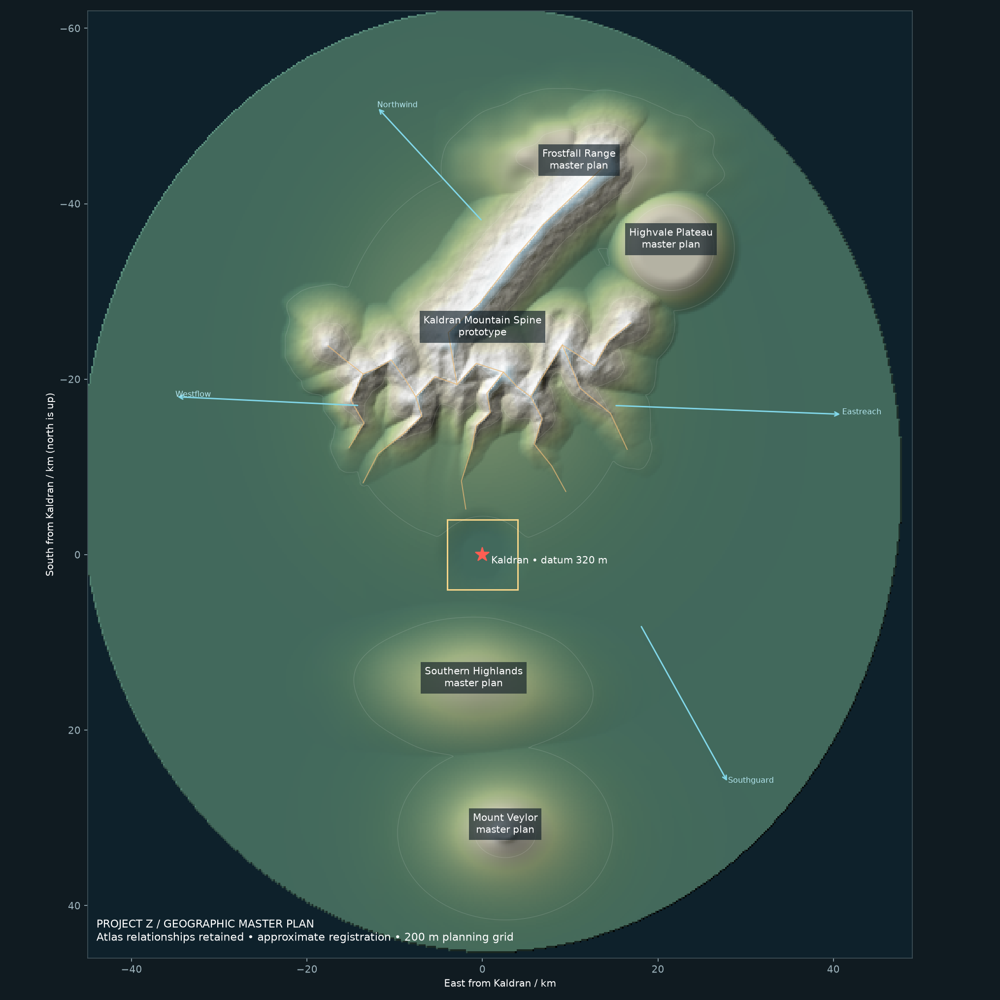
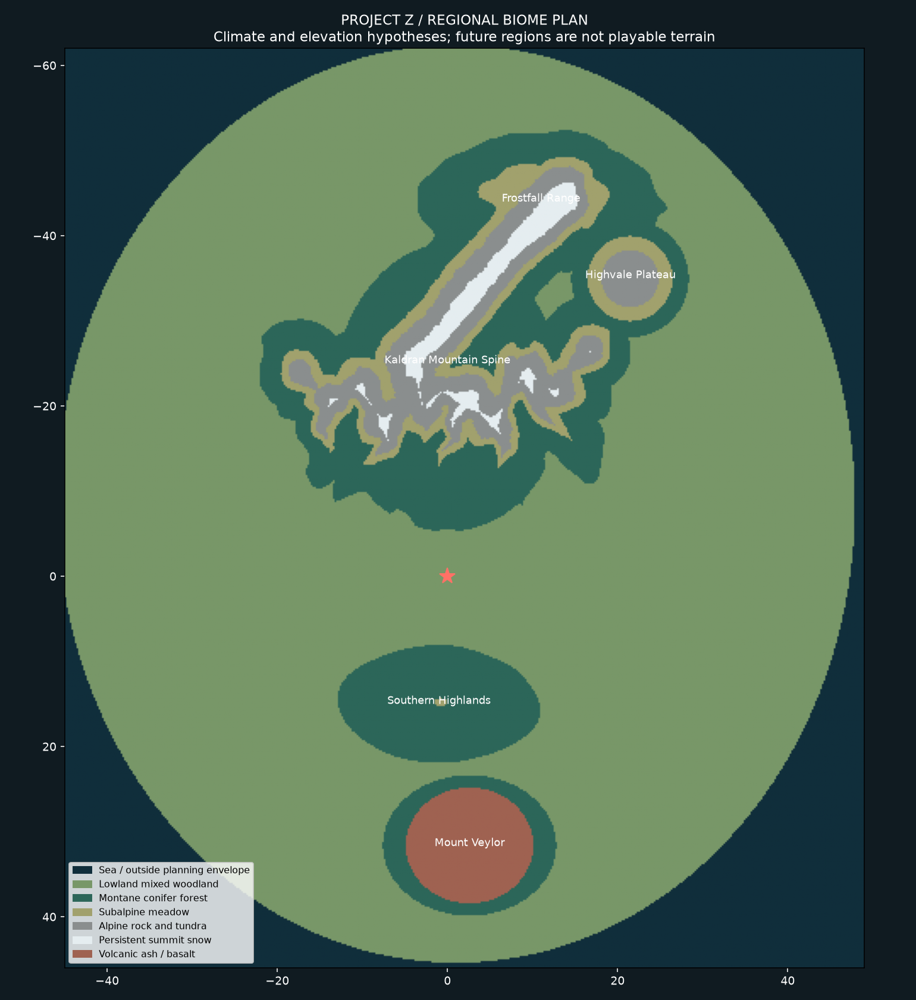

# Geography constraints

The supplied atlas controls names and regional relationships. The five environmental images control skyline composition, surface character and atmosphere. No survey, DEM, camera intrinsics or real-world coordinates were supplied. The registration is hand estimated and should be treated as an editable proposal.

| Region | Proposed centre, X/Z metres from Kaldran | Elevation constraint | Delivered state |
|---|---|---|---|
| Frostfall Range | +11,000 / -44,000 | Frostfall Peak 3,742 m | Northern planning envelope |
| Kaldran Mountain Spine | 0 / -25,000 | Prototype summit 3,415 m | Central terrain and skyline |
| Highvale Plateau | +21,500 / -35,000 | Proposed upland 1,850 m | Northeastern plateau plan |
| Southern Highlands | -1,000 / +15,000 | Proposed high point 1,670 m | Southern planning envelope |
| Mount Veylor | +2,600 / +31,700 | Atlas summit 2,816 m | Distinct volcanic blockout |

Frostfall's 3,742 m and Veylor's 2,816 m are preserved in region metadata. Their coarse 200 m planning rasters are not final summit geometry and should not be used as precise elevation validation. No full-detail Frostfall or Veylor production asset is claimed.

The lore remains approximately 8,960 km² across a 94 × 108 km extent. The planning map uses a simple island envelope to separate land and sea. It does **not** reconstruct the atlas coastline or reproduce the exact land area. The local decorative map scale and aspect differ; the central pixel registration therefore uses separate X and Z scales. Those choices are recorded in the source JSON.

Kaldran remains south of the central Spine. Frostfall sits farther north; Highvale is northeast; older highlands and the volcano lie south. Northwind, Westflow, Eastreach and Southguard drainage directions are recorded as broad planning arrows. Lake Harrow, Lake Mercy, Lake Lostre and Clearwater Lake retain their broad relative positions. These are guides, not completed connected water systems. Atlas labels that overlap or repeat are not silently interpreted as survey-accurate lake boundaries.

The square shown around Kaldran on the plan is the proposed 8 × 8 km release envelope. Only the separate Crown Approach walking core and its native collision collar are implemented here. There is not yet a continuous drivable release map connecting city streets, mountain roads and all named destinations.

## Camera reconciliation

All five cameras render the same central heightfield and summit coordinates. Each camera has one estimated position and fitted yaw, pitch and vertical field of view. The fit uses manually marked visible skyline spans. Occluded spans behind buildings, trees or clouds are excluded. The airport camera sits above the raised road at 420 m ASL. The asset pass lowers the hillside camera to terrain plus 1.9 m and refits its orientation/lens. The panoramic camera remains an elevated composition estimate, rather than a grounded viewpoint.

The images contain different skyline overlaps and inconsistent architectural scales. This build preserves shared geography and documents residual horizon error rather than deforming the terrain separately for each camera. Skyline measurements alone cannot verify snow patterns, mountain-to-city proportions, focal length, real altitude or a whole-scene match.

