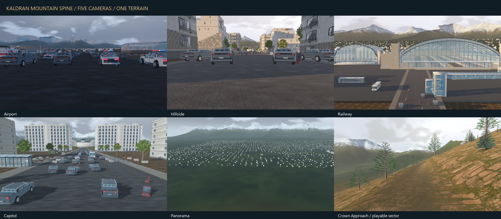
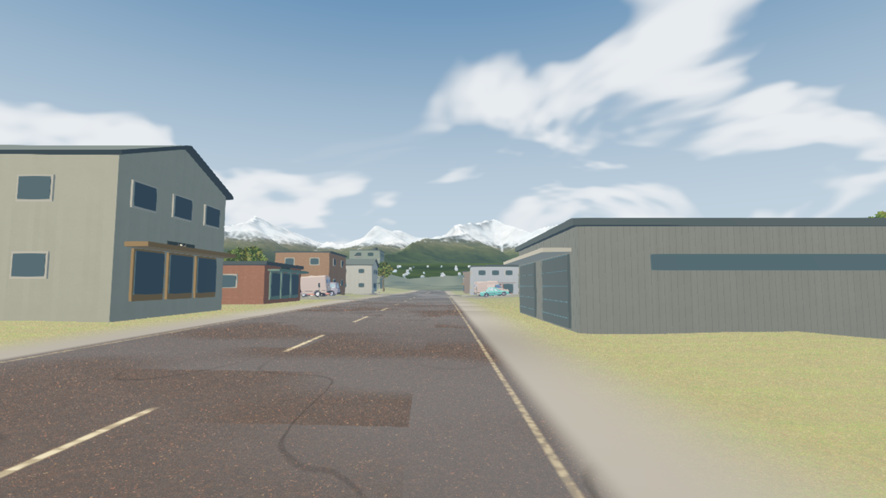

# Reference comparison

Each comparison sheet contains the supplied reference, an actual Godot render, an annotated horizon overlay, and an untextured view. No concept image is substituted for engine output. The same terrain is used for all cameras.

The visible skyline was manually traced in the 1,672 × 941 reference images. Yaw, pitch and vertical FOV were fitted at fixed estimated camera positions. Final measurements use separate actual 1,920 × 1,080 solid-terrain renders. Gold is the reference annotation; cyan is the rendered horizon. Only the explicitly annotated visible spans are scored.

| Camera | Columns scored | Vertical MAE, px | Vertical RMSE, px | p95 absolute error, px | Comparison |
|---|---:|---:|---:|---:|---|
| Airport | 561 | 8.2 | 9.7 | 16.7 | [Sheet](../08_Reference_Validation/Airport/comparison.png) |
| Hillside | 586 | 17.5 | 19.5 | 31.4 | [Sheet](../08_Reference_Validation/Hillside/comparison.png) |
| Railway | 416 | 6.2 | 7.9 | 15.3 | [Sheet](../08_Reference_Validation/Railway/comparison.png) |
| Capitol | 289 | 9.0 | 10.7 | 21.9 | [Sheet](../08_Reference_Validation/Capitol/comparison.png) |
| Panorama | 1666 | 13.8 | 16.3 | 29.8 | [Sheet](../08_Reference_Validation/Panorama/comparison.png) |

Manual trace uncertainty is roughly 5–15 px at original resolution. Occluded and unannotated spans are excluded. These are vertical image-space errors after camera fitting; they are not independent validation of a surveyed landscape, an accuracy percentage, or a score for materials, snow, lighting, city proportions or photographic realism.

## Visible deviations

- The central range has a coherent broad skyline, but its major faces are smoother and less geologically varied than the references. More branching ridges, exposed cliffs and erosion detail are needed.
- Urban foregrounds use supplied terminal, station, government and residential models, with evacuation traffic and props. The layout, surface weathering, distant skyline density and lighting still differ substantially from the photographic references.
- The panorama remains substantially elevated above local ground. The hillside camera is now grounded at terrain plus 1.9 m; railway and panorama viewpoints remain composition estimates. A matching horizon does not resolve those camera and terrain ambiguities.
- Supplied mature conifers, firs, shrubs, grass, deadwood and granite replace the initial vegetation proxies. Their procedural source art, density and material repetition remain visible limitations. Terrain snow is a continuous shader approximation; foliage switches to the supplied winter model. There is no volumetric snow depth or glacier geometry.
- Cloud cards and the sky blend provide weather context but do not reproduce the reference cloud shapes, detailed scattering or moving cloud shadows.

## Acceptance status

| Criterion | Current result |
|---|---|
| One shared physical range / five cameras | Implemented and rendered |
| Editable terrain, Float32 sources and GLBs | Implemented; source checks pass |
| Walking, collision, native-region boundary | Runtime checks pass |
| LOD and resource streaming | Runtime activity and unload verified; exhaustive visual sweep outstanding |
| Seasons and eight lighting presets | Rendered; physical weather simulation not implemented |
| Exact atlas coastline / all island regions | Planning approximation only |
| Reference photorealism and geological benchmark | Not achieved; production art work remains |
| Complete 64 km² release gameplay | Not implemented |
| Full-game performance guarantee | Not established |

The result is the requested first playable prototype and an editable basis for the next art pass. It is not accepted as a finished AAA mountain sector.

