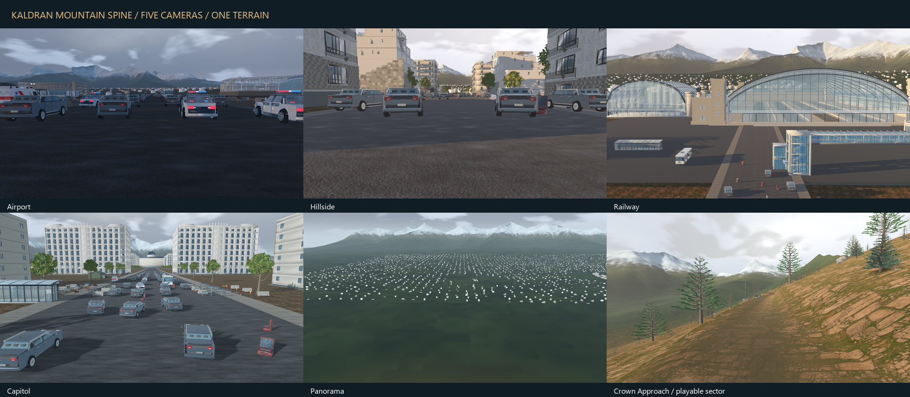

# Project Z — Kaldran Mountain Spine

**First playable terrain prototype, built and rendered in Godot.** This package contains a shared central mountain range, five reference cameras, an editable walking sector, geographic planning data and the source pipeline. It is an initial technical and composition milestone; the photorealistic AAA art target is still outstanding.

## Run

Double-click **Play_Mountains.cmd**. It locates the Godot 4.7.2 installation beside your Project Z workspace. Use **Edit_Mountains.cmd** to open the project in the editor. No download is needed on this machine.

If the folder is moved, set `GODOT_EXE` to a Godot 4.7.2 Windows executable or pass `-GodotPath` to `Launch.ps1`. The bundled Terrain3D native binaries are for Windows x64. The archive excludes the Godot cache; the play launcher imports assets automatically on its first run.

| Control | Action |
|---|---|
| 1–5 | Airport, hillside, railway, capitol, panorama |
| 6 | Enter the Crown Approach walking sector |
| WASD / mouse | Walk / look |
| Shift / Space | Sprint / jump |
| F, then Q/E | Free flight; descend / ascend |
| Esc / left click | Release / capture mouse |
| R / P | Cycle weather / switch quality profile |
| C / H | Untextured terrain / hide review panel |
| Season slider | Continuously blend summer, autumn, winter and spring |

The optional **Review_In_Existing_City.cmd** opens a separate integration scene in the adjacent `project_z` game, using an isolated test save directory. The mountain walking sector is in the standalone project. The city review does not create a traversable route from the city to that sector.

## Delivered scope

- A **49.152 × 49.152 km** central terrain source at 32 m sampling; 144 background tiles with three mesh LODs each. This is the skyline's source domain, not 2,416 km² of finished playable content.
- A **1.024 × 1.024 km** walking core, with a 1 km collar on each side: nine editable Terrain3D regions at 2 m sampling. A roughly 972 m contour trail, terrain/trunk/rock collision, streamed trees, boulders and a cliff test asset.
- One physical ridge and valley system shared by all five cameras; seasonal snow, eight lighting/weather presets, two quality profiles and a clay view.
- Supplied Kaldran architecture and evacuation props in editable airport, railway, hillside and civic scenes. Mature conifers, alpine plants, granite, deadwood, a radio outpost and cable station dress the walking sector. See [asset integration](09_Documentation/User_Asset_Integration.md) for sources, adaptations and exclusions.
- Float32 height sources, masks, GLB editing meshes, parameter JSON, generation scripts, reference overlays and measured QA reports.
- Island region placement and biome plans. Frostfall, Highvale, the Southern Highlands and Veylor remain **planning data**, not finished regions. The release's proposed 64 km² is also not yet fully playable.

## Review

- [Terrain design and generation plan](09_Documentation/Terrain_Design.md)
- [Atlas constraints and scope](09_Documentation/Geography_Constraints.md)
- [Editing, rebuilding and city integration](09_Documentation/Import_And_Editing.md)
- [Measured performance and limitations](09_Documentation/Performance_Report.md)
- [Reference comparisons and deviations](09_Documentation/Reference_Comparison.md)
- [Technical manifest](09_Documentation/Technical_Manifest.json)
- [Asset provenance](09_Documentation/Asset_Provenance.md)

## Remaining production work

The terrain is usable for walking, editing and skyline iteration. Broad faces still need stronger geological sculpting, erosion and moraine detail. Supplied models replace the original urban and forest placeholders, but district composition, distant building detail, material repetition and atmospheric cloud cards still need production art work. Named rivers/lakes currently have planning guides and masks, not finished water geometry. The snow model uses environmental heuristics rather than a physical accumulation simulation; supplied winter conifers switch at the winter phase while terrain snow blends continuously.

Camera positions and lenses are estimates from images without survey data. The reported skyline errors measure selected visible horizon spans only; they do not establish a photorealistic or full-scene match. There is no baked NPC navigation mesh or exported `.blend` file. Godot terrain resources, GLBs and Float32 sources are the editable deliverables.

Runtime tests and short static frame measurements are included. They do not replace a long traversal test, seam inspection from every direction, or profiling inside the complete game. See the reports before treating this as a production quality benchmark.
